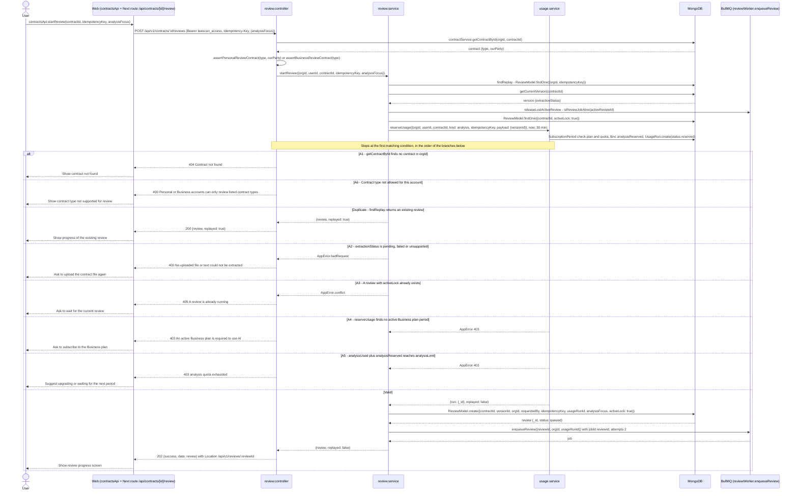
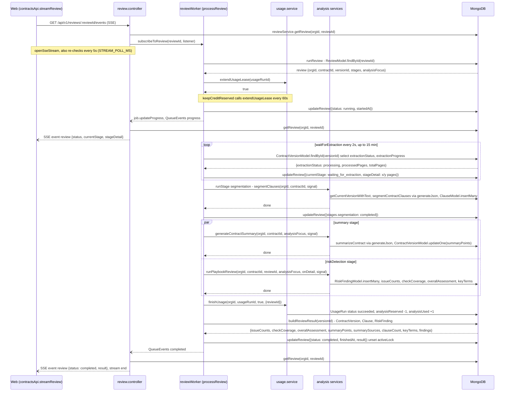
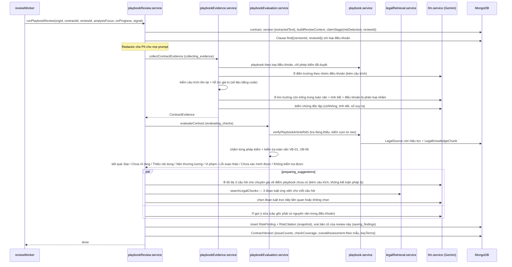

# AI Review — Flows

## Flow: Gửi yêu cầu rà soát hợp đồng
**Trigger**: Người dùng bấm "Rà soát" trên một hợp đồng đã tải lên
**Related UC**: TBD
**Related FR**: TBD
**Related E**: TBD

## Flow: Xử lý rà soát nền và theo dõi tiến độ
**Trigger**: Phiên rà soát vừa được đưa vào hàng đợi xử lý nền
**Related UC**: TBD
**Related FR**: TBD
**Related E**: —

## Flow: Phát hiện rủi ro hợp đồng
**Trigger**: reviewWorker gọi `runPlaybookReview` ở giai đoạn riskDetection
**Related UC**: TBD
**Related FR**: TBD
**Related E**: —

Nguyên tắc: AI chỉ đọc và trích dẫn; mọi kết luận do phép kiểm trong playbook (dữ liệu có phiên bản, có căn cứ, đã duyệt) quyết định bằng code. Không có mức rủi ro cao/trung bình/thấp.

| Kết quả của phép kiểm | Khi nào | Lưu thành |
| --- | --- | --- |
| Đạt | Hợp đồng đáp ứng tiêu chí | Chỉ đếm trong `checkCoverage.passed` |
| Chưa rõ ràng / Thiếu nội dung / Nên thương lượng | Phép kiểm nhóm rõ ràng / đầy đủ / cân bằng không đạt | `RiskFinding` `outcome=failed` |
| Vi phạm | Phép kiểm tuân thủ không đạt, điều luật **và** điều kiện áp dụng đều đã xác minh | `RiskFinding` `checkGroup=compliance` |
| Lỗi soạn thảo | Kiểm tra toàn văn VB-01..VB-04: chỗ trống, dẫn chiếu đến điều hoặc phụ lục không có, số tiền bằng số khác bằng chữ | `RiskFinding` `checkGroup=drafting` |
| Chưa xác minh được | Phép kiểm tuân thủ không đạt nhưng chưa xác định được tình tiết hoặc điều luật | `RiskFinding` `outcome=unverified` |
| Không kiểm tra được | Giá trị đọc từ hợp đồng không chắc chắn | `checkCoverage.notCheckedItems` |
| Đề nghị chuyên gia xem xét | AI đặt câu hỏi về điểm playbook chưa có; không trùng vị trí với vấn đề đã báo; câu có kết luận pháp lý hoặc nêu tên luật, điều luật bị loại bằng code | `RiskFinding` `findingType=referral`, không tính vào `issueCounts.total` |
