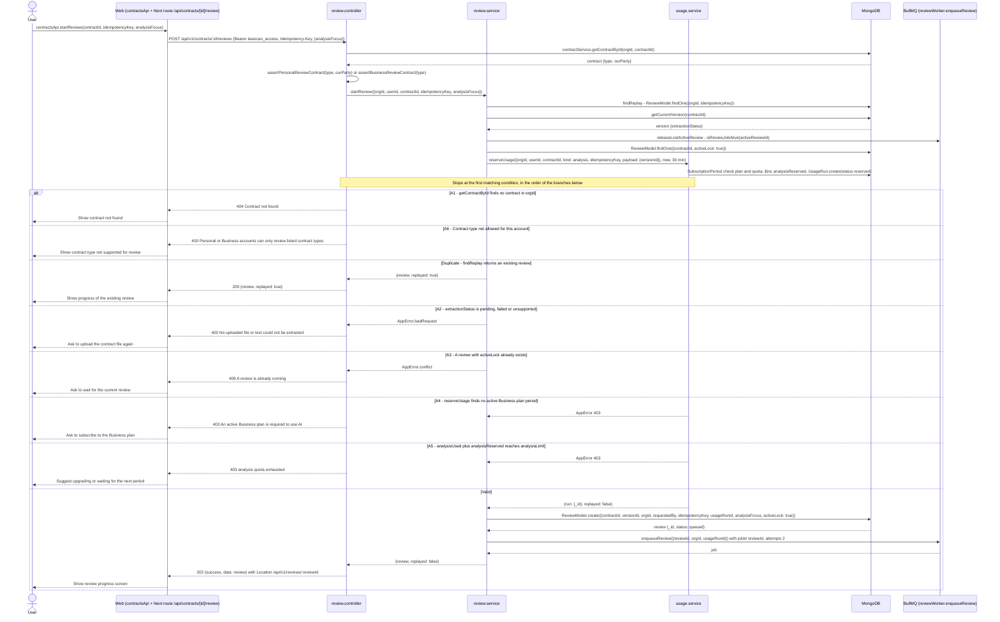
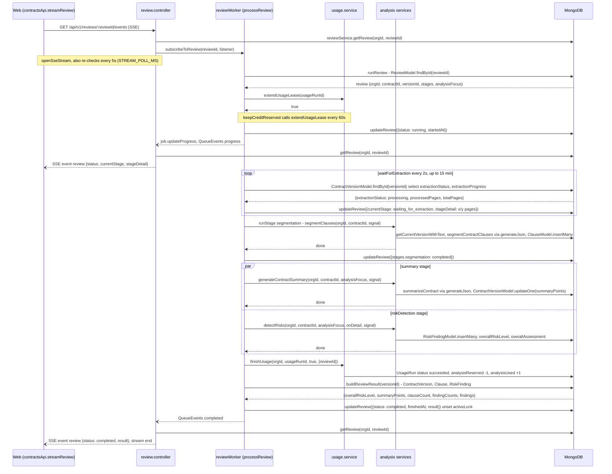
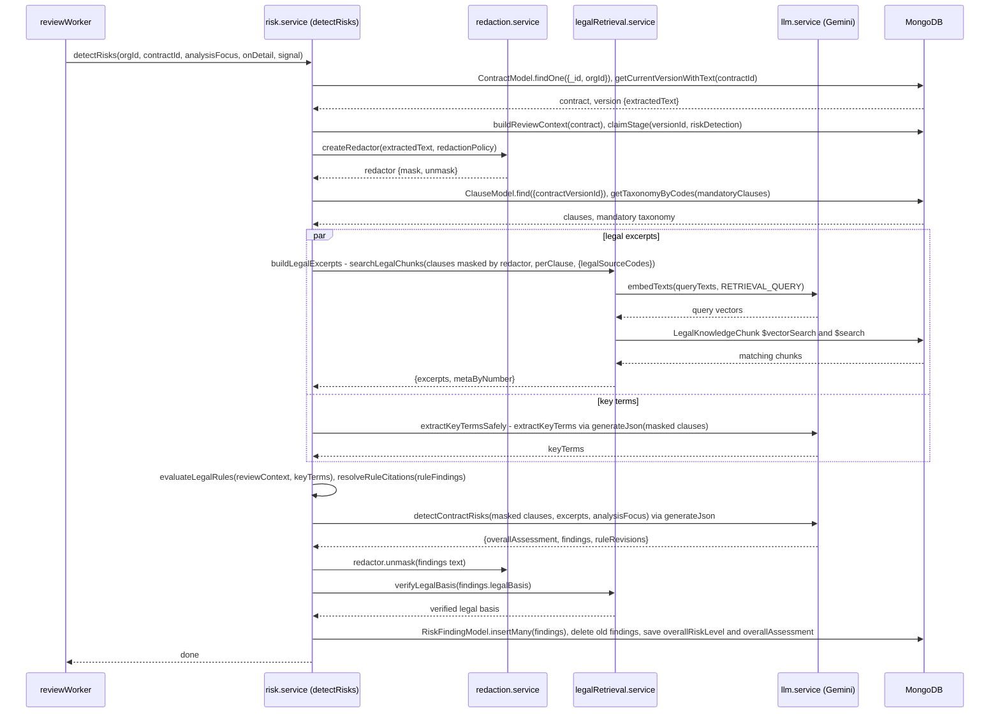

# AI Review — Flows

## Flow: Gửi yêu cầu rà soát hợp đồng
**Trigger**: Người dùng bấm "Rà soát" trên một hợp đồng đã tải lên
**Related UC**: TBD
**Related FR**: TBD
**Related E**: TBD

## Flow: Xử lý rà soát nền và theo dõi tiến độ
**Trigger**: Phiên rà soát vừa được đưa vào hàng đợi xử lý nền
**Related UC**: TBD
**Related FR**: TBD
**Related E**: —

## Flow: Phát hiện rủi ro hợp đồng
**Trigger**: reviewWorker gọi `detectRisks` ở giai đoạn riskDetection
**Related UC**: TBD
**Related FR**: TBD
**Related E**: —

