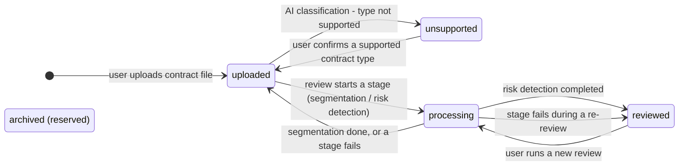
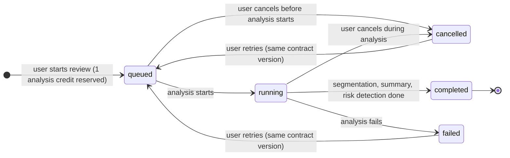

# AI Review — States

## State: Contract
**Related entity**: Contract
**Related UC**: —
**Related BR**: —

### Invalid transitions
| From | To | Why not |
|---|---|---|
| unsupported | processing | A review needs a confirmed, supported contract type first |
| processing | processing | Only one analysis may run per contract at a time |
| uploaded | reviewed | Reviewed is only reached after risk detection completes |

## State: Review
**Related entity**: Review
**Related UC**: —
**Related BR**: —

### Invalid transitions
| From | To | Why not |
|---|---|---|
| completed | queued | Only failed or cancelled reviews can be retried |
| failed / cancelled | queued | Not allowed when the contract has a newer version, start a new review instead |
| completed / failed / cancelled | cancelled | A finished review cannot be cancelled |
| any | queued | Not allowed while another review of the same contract is active |
