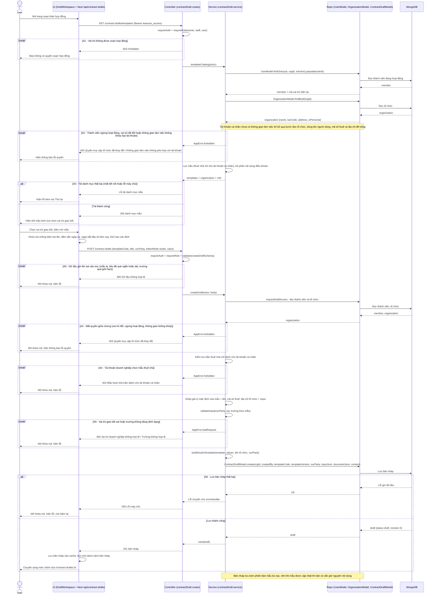

# Contract Drafting — Flows

## Flow: Tạo bản nháp hợp đồng từ mẫu
**Trigger**: Người dùng mở trang soạn thảo, chọn một mẫu hợp đồng và bấm mở mẫu
**Related UC**: TBD
**Related FR**: TBD
**Related E**: TBD

