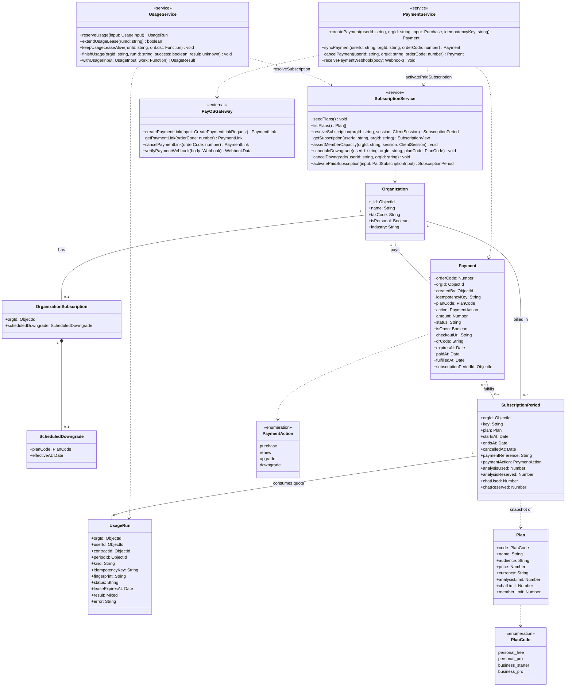
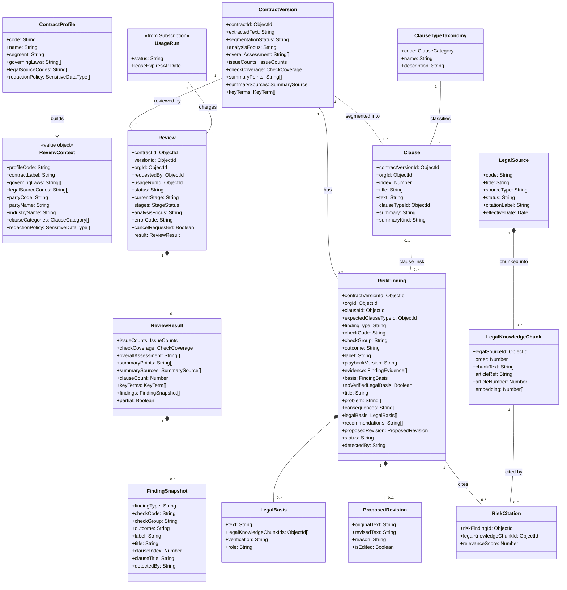

# core-data-model — Class Diagrams: Subscription và AI Risk Detection

> Scope: gói dịch vụ, thanh toán payOS, giữ chỗ credit (usage) và pipeline AI phát hiện rủi ro hợp đồng (rule + LLM + RAG pháp lý)

Ba sơ đồ: **1** gói dịch vụ và thanh toán, **2a** pipeline AI phát hiện rủi ro, **2b** dữ liệu review và rủi ro. Các sơ đồ nối nhau qua `UsageRun` và `UsageService`: mỗi `Review` giữ chỗ 1 credit analysis bằng 1 `UsageRun` trừ vào `SubscriptionPeriod`, và `ReviewWorker` gọi `finishUsage` để chốt hoặc hoàn credit khi rà soát kết thúc. Khối gắn `<<from Subscription>>` hoặc `<<model>>` là bản rút gọn của class được mô tả đầy đủ ở sơ đồ khác.

## Sơ đồ 1 — Gói dịch vụ và thanh toán

### Classes — Subscription

| Class | Vai trò |
| --- | --- |
| `Plan` | Gói dịch vụ (4 mã cố định), giá do server tính, hạn mức analysis / chat / member |
| `OrganizationSubscription` | 1 bản ghi/tổ chức, giữ lịch hạ gói (`ScheduledDowngrade`) đến hết kỳ |
| `SubscriptionPeriod` | Một kỳ sử dụng; lưu bản sao gói tại thời điểm mua và bộ đếm used/reserved |
| `UsageRun` | Phiếu giữ chỗ 1 lượt analysis/chat có lease; `succeeded` thì trừ hẳn, `failed` thì hoàn |
| `Payment` | Đơn payOS; mỗi tổ chức chỉ 1 đơn mở; khi `paid` thì kích hoạt `SubscriptionPeriod` |

### Relationships — Subscription

| From | To | Kiểu | Ý nghĩa |
| --- | --- | --- | --- |
| `SubscriptionPeriod` | `UsageRun` | association 1–n | Credit được trừ vào kỳ đang hiệu lực |
| `Payment` | `SubscriptionPeriod` | association 0..1–0..1 | Đơn đã thanh toán sinh ra kỳ mới (purchase/renew/upgrade) |
| `PaymentService` | `PayOSGateway` | dependency | Tạo/hủy link thanh toán, xác thực chữ ký webhook |
| `PaymentService` | `SubscriptionService` | dependency | Webhook `paid` gọi `activatePaidSubscription` để mở kỳ mới |

## Sơ đồ 2a — Pipeline AI phát hiện rủi ro

```mermaid
classDiagram
    direction TB

    class ReviewWorker {
        <<worker>>
        +enqueueReview(data: ReviewJobData) Job
        +processReview(job: Job) void
        +finishUnsuccessfulReview(reviewId: string, code: ReviewErrorCode, message: string) void
        -runStage(job: Job, key: StageKey, stage: ReviewStage, task: Function) void
    }
    class UsageService {
        <<from Subscription>>
        +finishUsage(orgId: string, runId: string, success: boolean, result: unknown) void
    }
    class UsageRun {
        <<from Subscription>>
        +status: String
        +leaseExpiresAt: Date
    }
    class RiskService {
        <<service>>
        +listRiskFindings(orgId: string, contractId: string) RiskFinding[]
        +updateProposedRevision(orgId: string, contractId: string, findingId: string, input: RevisionInput) RiskFinding
        +removeProposedRevision(orgId: string, contractId: string, findingId: string) RiskFinding
    }
    class PlaybookReviewService {
        <<service>>
        +runPlaybookReview(orgId: string, contractId: string, reviewId: string, analysisFocus: string, onProgress: Function, signal: AbortSignal) ReviewOutcome
        -findReferrals() Referral[]
        -draftSuggestions() Map
    }
    class PlaybookEvidenceService {
        <<service>>
        +collectContractEvidence(context: ReviewContext, clauses: EvidenceClause[], redactor: Redactor, signal: AbortSignal) ContractEvidence
    }
    class PlaybookEvaluationService {
        <<service>>
        +evaluateContract(contractType: string, userParty: string, clauses: EvidenceClause[], evidence: ContractEvidence) PlaybookEvaluation
    }
    class DocumentCheckService {
        <<service>>
        +runDocumentChecks(clauses: EvidenceClause[], conflictFields: FieldEvidence[]) DocumentFinding[]
    }
    class PlaybookService {
        <<service>>
        +getClausePlaybook(clauseType: ClauseCategory) ClausePlaybook
        +getContractPlaybook(contractType: string) ContractPlaybook
        +verifyPlaybookArticleRefs(refs: ArticleRef[]) ArticleRefResult[]
        +checkPlaybooksOnStartup() void
    }
    class ClausePlaybook {
        <<data>>
        +clauseTypes: ClauseCategory[]
        +fields: PlaybookField[]
        +checks: PlaybookCheck[]
    }
    class PlaybookCheck {
        <<data>>
        +code: String
        +group: CheckGroup
        +appliesTo: Applicability
        +test: CheckTest
        +basis: CheckBasis
        +fallbackRules: FallbackRule[]
        +review: CheckReview
    }
    class LegalRetrievalService {
        <<service>>
        +searchLegalChunks(queryTexts: string[], topKPerQuery: number, options: LegalSearchOptions) LegalChunkMatch[][]
        -vectorSearch(queryVector: number[], limit: number, legalSourceIds: ObjectId[]) ChunkHit[]
        -textSearch(query: string, limit: number, legalSourceIds: ObjectId[]) ChunkHit[]
        -fuseByReciprocalRank(lists: RankedHits[], topK: number) LegalChunkMatch[]
    }
    class Redactor {
        <<interface>>
        +spans: SensitiveSpan[]
        +mask(text: string) String
        +unmask(text: string) String
        +maskForDisplay(text: string) DisplayMaskedText
        +createStreamUnmasker() StreamUnmasker
    }
    class LlmService {
        <<external>>
        +generateJson(prompt: string, responseSchema: Schema, signal: AbortSignal) unknown
        +generateText(prompt: string, systemInstruction: string, signal: AbortSignal) String
        +generateTextStream(prompt: string, systemInstruction: string, signal: AbortSignal) AsyncIterable
        +embedTexts(texts: string[], options: EmbedOptions) Number[][]
    }
    class Review {
        <<model>>
    }
    class ContractProfile {
        <<model>>
    }
    class RiskFinding {
        <<model>>
    }
    class LegalKnowledgeChunk {
        <<model>>
    }

    ReviewWorker ..> UsageService : finishUsage
    ReviewWorker ..> Review
    ReviewWorker ..> PlaybookReviewService : risk_detection stage
    UsageService ..> UsageRun
    PlaybookReviewService ..> ContractProfile : buildReviewContext
    PlaybookReviewService ..> PlaybookEvidenceService : 1. evidence
    PlaybookReviewService ..> PlaybookEvaluationService : 2. evaluate
    PlaybookReviewService ..> LegalRetrievalService : referral hints
    PlaybookReviewService ..> RiskFinding : saves
    PlaybookReviewService ..> Redactor : createRedactor
    PlaybookEvidenceService ..> PlaybookService
    PlaybookEvidenceService ..> LlmService : generateJson
    PlaybookEvidenceService ..> Redactor : mask / unmask
    PlaybookEvaluationService ..> PlaybookService : verify articles
    PlaybookEvaluationService ..> DocumentCheckService
    PlaybookService "1" o-- "0..*" ClausePlaybook
    ClausePlaybook "1" *-- "1..*" PlaybookCheck
    PlaybookService ..> LegalKnowledgeChunk : exact article lookup
    LegalRetrievalService ..> LegalKnowledgeChunk : vectorSearch + search
    LegalRetrievalService ..> LlmService : embedTexts
    RiskService ..> RiskFinding : reads
```

### Classes — Pipeline

| Class | Vai trò |
| --- | --- |
| `ReviewWorker` | Worker BullMQ chạy 3 stage của 1 `Review`; khi kết thúc gọi `finishUsage` để chốt hoặc hoàn credit |
| `PlaybookReviewService` | Điều phối stage risk detection: thu thập bằng chứng, chấm phép kiểm, đề nghị chuyên gia xem xét, gợi ý sửa, lưu `RiskFinding` và thống kê phạm vi |
| `PlaybookEvidenceService` | AI điền các trường của playbook kèm câu trích; backend kiểm câu trích tồn tại và hỗ trợ giá trị; xác định tình tiết của hợp đồng |
| `PlaybookEvaluationService` | Chấm từng phép kiểm bằng quy tắc cố định; AI không kết luận |
| `DocumentCheckService` | Kiểm tra tất định trên toàn văn: chỗ trống, dẫn chiếu sai, số ≠ chữ, từ mơ hồ, giá trị mâu thuẫn |
| `PlaybookService` | Đăng ký playbook, kiểm tra cấu trúc khi khởi động, đối chiếu điều luật trong kho luật |
| `PlaybookCheck` | Tiêu chí có mã, nhóm, điều kiện áp dụng, căn cứ và trạng thái duyệt; chỉ phép kiểm đã duyệt mới chạy |
| `RiskService` | Đọc phát hiện kèm trích dẫn; sửa hoặc xoá đề xuất sửa |
| `Redactor` | Che dữ liệu nhạy cảm trước khi gửi LLM và khôi phục sau khi nhận kết quả |
| `LlmService` | Cổng duy nhất gọi Gemini: sinh JSON/text và tạo embedding |

### Relationships — Pipeline

| From | To | Kiểu | Ý nghĩa |
| --- | --- | --- | --- |
| `PlaybookReviewService` | `PlaybookEvidenceService`, `PlaybookEvaluationService` | dependency | Thứ tự: thu thập bằng chứng, chấm, đề nghị chuyên gia, gợi ý sửa, lưu |
| `ClausePlaybook` | `PlaybookCheck` | composition | Mỗi loại điều khoản có bộ phép kiểm riêng |
| `PlaybookService` | `LegalKnowledgeChunk` | dependency | Tra đúng Điều luật mà phép kiểm dẫn chiếu và kiểm cụm từ neo |
| `PlaybookReviewService` | `LegalRetrievalService` | dependency | RAG chỉ gắn điều luật tham khảo cho mục đề nghị chuyên gia xem xét |

## Sơ đồ 2b — Dữ liệu review và rủi ro

### Classes — Dữ liệu

| Class | Vai trò |
| --- | --- |
| `Review` | 1 lần rà soát gồm 3 stage segmentation / summary / riskDetection, gắn với 1 `UsageRun` |
| `ReviewContext` | Ngữ cảnh rà soát dựng từ `ContractProfile` + ngành của tổ chức (luật áp dụng, điều khoản bắt buộc, chính sách che dữ liệu) |
| `RiskFinding` | Một phép kiểm không đạt trên 1 điều khoản (`clause_risk`), nội dung bị thiếu (`missing_clause`) hoặc một điểm đề nghị chuyên gia xem xét (`referral`); có mã phép kiểm, nhóm, nhãn cố định, bằng chứng trích nguyên văn và căn cứ. Nguồn `playbook` / `document_check` / `expert_referral` / `expert`; không có mức độ nghiêm trọng |
| `LegalBasis` | Căn cứ pháp lý, có trạng thái đối chiếu kho luật (`verified` … `unreferenced`) |
| `RiskCitation` | Liên kết finding với đoạn luật kèm điểm liên quan |

### Relationships — Dữ liệu

| From | To | Kiểu | Ý nghĩa |
| --- | --- | --- | --- |
| `UsageRun` | `Review` | association 1–1 | Mỗi lần rà soát giữ chỗ 1 credit analysis |
| `ContractVersion` | `Review`, `Clause`, `RiskFinding` | association 1–n | Mọi kết quả rà soát gắn với 1 phiên bản hợp đồng |
| `RiskFinding` | `LegalBasis`, `ProposedRevision` | composition | Dữ liệu nhúng trong finding; `ProposedRevision` được mã hóa khi lưu |
| `RiskCitation` | `RiskFinding`, `LegalKnowledgeChunk` | association n–1 | Bảng nối finding với đoạn luật được trích dẫn |
| `LegalSource` | `LegalKnowledgeChunk` | composition | Văn bản luật được chia đoạn và nhúng embedding để tìm kiếm |
