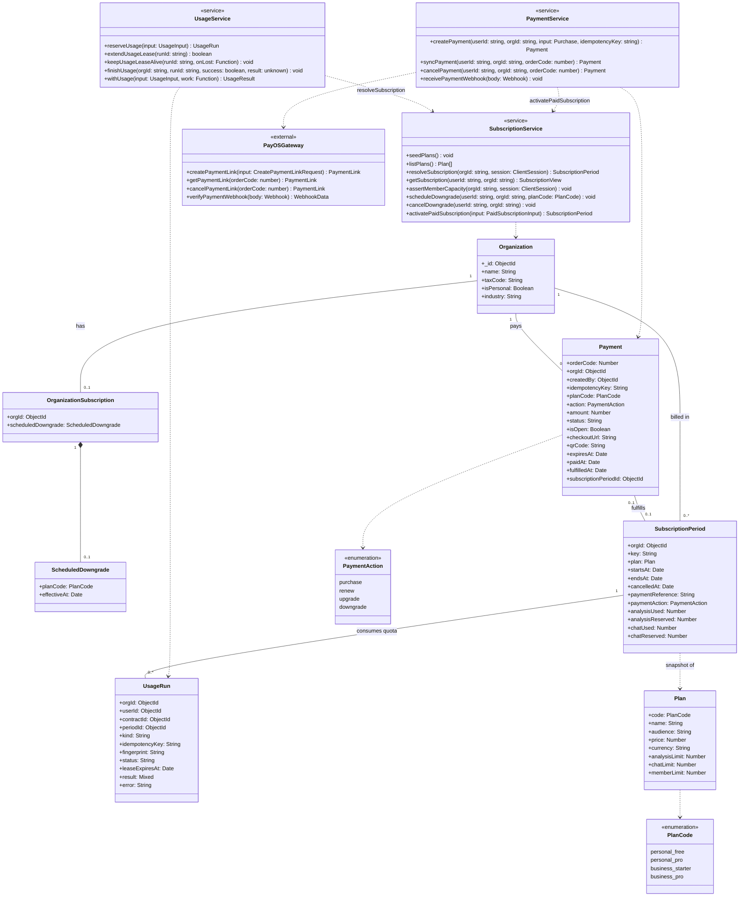
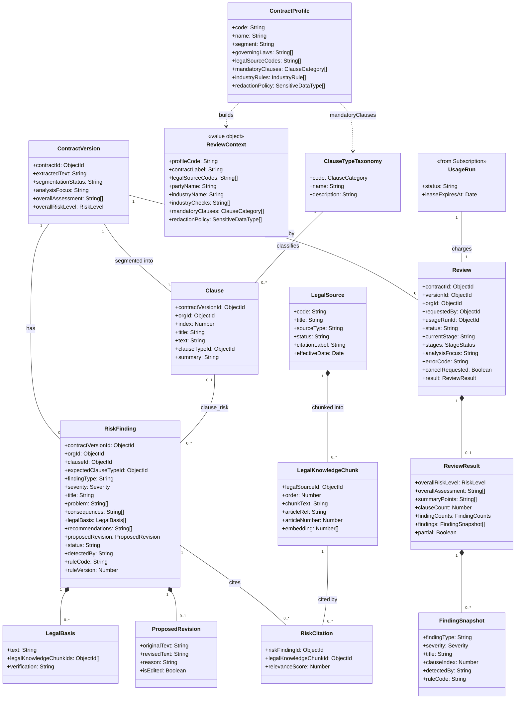

# core-data-model — Class Diagrams: Subscription và AI Risk Detection

> Scope: gói dịch vụ, thanh toán payOS, giữ chỗ credit (usage) và pipeline AI phát hiện rủi ro hợp đồng (rule + LLM + RAG pháp lý)

Ba sơ đồ: **1** gói dịch vụ và thanh toán, **2a** pipeline AI phát hiện rủi ro, **2b** dữ liệu review và rủi ro. Các sơ đồ nối nhau qua `UsageRun` và `UsageService`: mỗi `Review` giữ chỗ 1 credit analysis bằng 1 `UsageRun` trừ vào `SubscriptionPeriod`, và `ReviewWorker` gọi `finishUsage` để chốt hoặc hoàn credit khi rà soát kết thúc. Khối gắn `<<from Subscription>>` hoặc `<<model>>` là bản rút gọn của class được mô tả đầy đủ ở sơ đồ khác.

## Sơ đồ 1 — Gói dịch vụ và thanh toán

### Classes — Subscription

| Class | Vai trò |
| --- | --- |
| `Plan` | Gói dịch vụ (4 mã cố định), giá do server tính, hạn mức analysis / chat / member |
| `OrganizationSubscription` | 1 bản ghi/tổ chức, giữ lịch hạ gói (`ScheduledDowngrade`) đến hết kỳ |
| `SubscriptionPeriod` | Một kỳ sử dụng; lưu bản sao gói tại thời điểm mua và bộ đếm used/reserved |
| `UsageRun` | Phiếu giữ chỗ 1 lượt analysis/chat có lease; `succeeded` thì trừ hẳn, `failed` thì hoàn |
| `Payment` | Đơn payOS; mỗi tổ chức chỉ 1 đơn mở; khi `paid` thì kích hoạt `SubscriptionPeriod` |

### Relationships — Subscription

| From | To | Kiểu | Ý nghĩa |
| --- | --- | --- | --- |
| `SubscriptionPeriod` | `UsageRun` | association 1–n | Credit được trừ vào kỳ đang hiệu lực |
| `Payment` | `SubscriptionPeriod` | association 0..1–0..1 | Đơn đã thanh toán sinh ra kỳ mới (purchase/renew/upgrade) |
| `PaymentService` | `PayOSGateway` | dependency | Tạo/hủy link thanh toán, xác thực chữ ký webhook |
| `PaymentService` | `SubscriptionService` | dependency | Webhook `paid` gọi `activatePaidSubscription` để mở kỳ mới |

## Sơ đồ 2a — Pipeline AI phát hiện rủi ro

```mermaid
classDiagram
    direction TB

    class ReviewWorker {
        <<worker>>
        +enqueueReview(data: ReviewJobData) Job
        +processReview(job: Job) void
        +finishUnsuccessfulReview(reviewId: string, code: ReviewErrorCode, message: string) void
        -runStage(job: Job, key: StageKey, stage: ReviewStage, task: Function) void
    }
    class UsageService {
        <<from Subscription>>
        +finishUsage(orgId: string, runId: string, success: boolean, result: unknown) void
    }
    class UsageRun {
        <<from Subscription>>
        +status: String
        +leaseExpiresAt: Date
    }
    class RiskService {
        <<service>>
        +detectRisks(orgId: string, contractId: string, analysisFocus: string, onProgress: Function, signal: AbortSignal) RiskSummary
        +listRiskFindings(orgId: string, contractId: string) RiskFinding[]
        +updateProposedRevision(orgId: string, contractId: string, findingId: string, input: RevisionInput) RiskFinding
        +removeProposedRevision(orgId: string, contractId: string, findingId: string) RiskFinding
    }
    class KeyTermExtractionService {
        <<service>>
        +extractKeyTerms(context: ReviewContext, clauses: ClauseText[], redactor: Redactor, signal: AbortSignal) ExtractedKeyTerm[]
    }
    class LegalRulesService {
        <<service>>
        +evaluateLegalRules(context: ReviewContext, keyTerms: ExtractedKeyTerm[]) RuleFinding[]
        +resolveRuleCitations(findings: RuleFinding[]) Map
    }
    class LegalRetrievalService {
        <<service>>
        +searchLegalChunks(queryTexts: string[], topKPerQuery: number, options: LegalSearchOptions) LegalChunkMatch[][]
        +verifyLegalBasis(items: LegalBasisToVerify[]) VerifiedLegalBasis[]
        -vectorSearch(queryVector: number[], limit: number, legalSourceIds: ObjectId[]) ChunkHit[]
        -textSearch(query: string, limit: number, legalSourceIds: ObjectId[]) ChunkHit[]
        -fuseByReciprocalRank(lists: RankedHits[], topK: number) LegalChunkMatch[]
    }
    class RiskDetectionService {
        <<service>>
        +detectContractRisks(context: ReviewContext, clauses: ClauseInput[], legalExcerpts: LegalExcerptInput[], missingClauses: MissingClauseInput[], ruleFindings: RuleFindingInput[], analysisFocus: string, redactor: Redactor, signal: AbortSignal) RiskDetectionResult
        -buildPrompt() String
    }
    class LegalRule {
        +code: String
        +version: Number
        +profiles: String[]
        +severity: Severity
        +legalBasis: String
        +citations: RuleCitation[]
        +evaluate(terms: Terms, context: ReviewContext) RuleOutcome
    }
    class Redactor {
        <<interface>>
        +spans: SensitiveSpan[]
        +mask(text: string) String
        +unmask(text: string) String
        +maskForDisplay(text: string) DisplayMaskedText
        +createStreamUnmasker() StreamUnmasker
    }
    class LlmService {
        <<external>>
        +generateJson(prompt: string, responseSchema: Schema, signal: AbortSignal) unknown
        +generateText(prompt: string, systemInstruction: string, signal: AbortSignal) String
        +generateTextStream(prompt: string, systemInstruction: string, signal: AbortSignal) AsyncIterable
        +embedTexts(texts: string[], options: EmbedOptions) Number[][]
    }
    class Review {
        <<model>>
    }
    class ContractProfile {
        <<model>>
    }
    class RiskFinding {
        <<model>>
    }
    class LegalKnowledgeChunk {
        <<model>>
    }

    ReviewWorker ..> UsageService : finishUsage
    ReviewWorker ..> Review
    ReviewWorker ..> RiskService : risk_detection stage
    UsageService ..> UsageRun
    RiskService ..> ContractProfile : buildReviewContext
    RiskService ..> LegalRetrievalService
    RiskService ..> KeyTermExtractionService
    RiskService ..> RiskDetectionService
    RiskService ..> LegalRulesService
    RiskService ..> RiskFinding : saves
    RiskService ..> Redactor : createRedactor
    LegalRetrievalService ..> LegalKnowledgeChunk : vectorSearch + search
    LegalRetrievalService ..> LlmService : embedTexts
    KeyTermExtractionService ..> LlmService : generateJson
    RiskDetectionService ..> LlmService : generateJson
    RiskDetectionService ..> Redactor : mask / unmask
    LegalRulesService "1" o-- "0..*" LegalRule : evaluates
```

### Classes — Pipeline

| Class | Vai trò |
| --- | --- |
| `ReviewWorker` | Worker BullMQ chạy 3 stage của 1 `Review`; khi kết thúc gọi `finishUsage` để chốt hoặc hoàn credit |
| `RiskService` | Điều phối stage risk detection: dựng `ReviewContext`, tạo `Redactor`, gọi các service con, lưu `RiskFinding` |
| `LegalRule` | Luật kiểm tra cố định theo profile hợp đồng, chạy trên key term trích xuất |
| `Redactor` | Che dữ liệu nhạy cảm trước khi gửi LLM và khôi phục sau khi nhận kết quả |
| `LlmService` | Cổng duy nhất gọi Gemini: sinh JSON/text và tạo embedding |

### Relationships — Pipeline

| From | To | Kiểu | Ý nghĩa |
| --- | --- | --- | --- |
| `RiskService` | `LegalRetrievalService`, `KeyTermExtractionService`, `LegalRulesService`, `RiskDetectionService` | dependency | Thứ tự: tìm đoạn luật + trích key term, chạy rule, gọi LLM, đối chiếu căn cứ pháp lý, lưu finding |
| `LegalRulesService` | `LegalRule` | aggregation | Danh sách rule cố định được đánh giá trên key term |
| `RiskDetectionService` | `Redactor` | dependency | Che dữ liệu trước khi dựng prompt, khôi phục trong kết quả trả về |
| `LegalRetrievalService` | `LegalKnowledgeChunk` | dependency | Tìm kiếm kết hợp vector + full-text trên kho đoạn luật |

## Sơ đồ 2b — Dữ liệu review và rủi ro

### Classes — Dữ liệu

| Class | Vai trò |
| --- | --- |
| `Review` | 1 lần rà soát gồm 3 stage segmentation / summary / riskDetection, gắn với 1 `UsageRun` |
| `ReviewContext` | Ngữ cảnh rà soát dựng từ `ContractProfile` + ngành của tổ chức (luật áp dụng, điều khoản bắt buộc, chính sách che dữ liệu) |
| `RiskFinding` | Rủi ro trên 1 điều khoản (`clause_risk`) hoặc điều khoản bắt buộc bị thiếu (`missing_clause`); nguồn `rule` / `llm` / `hybrid` |
| `LegalBasis` | Căn cứ pháp lý, có trạng thái đối chiếu kho luật (`verified` … `unreferenced`) |
| `RiskCitation` | Liên kết finding với đoạn luật kèm điểm liên quan |

### Relationships — Dữ liệu

| From | To | Kiểu | Ý nghĩa |
| --- | --- | --- | --- |
| `UsageRun` | `Review` | association 1–1 | Mỗi lần rà soát giữ chỗ 1 credit analysis |
| `ContractVersion` | `Review`, `Clause`, `RiskFinding` | association 1–n | Mọi kết quả rà soát gắn với 1 phiên bản hợp đồng |
| `RiskFinding` | `LegalBasis`, `ProposedRevision` | composition | Dữ liệu nhúng trong finding; `ProposedRevision` được mã hóa khi lưu |
| `RiskCitation` | `RiskFinding`, `LegalKnowledgeChunk` | association n–1 | Bảng nối finding với đoạn luật được trích dẫn |
| `LegalSource` | `LegalKnowledgeChunk` | composition | Văn bản luật được chia đoạn và nhúng embedding để tìm kiếm |
