# core-data-model — Entity Relationship Diagram

> Scope: full data model of AI Contract Review — 31 entities (22 implemented, 9 planned), 6 business groups

## Diagram

```mermaid
erDiagram
    ROLE ||--o{ USER : ""
    ORGANIZATION |o--o{ USER : ""
    ORGANIZATION ||--o{ ORG_INVITATION : ""
    USER ||--o{ ORG_INVITATION : ""
    USER |o--o{ ORG_INVITATION : ""
    USER |o--o{ EMAIL_VERIFY : ""
    ORGANIZATION ||--o| ORG_SUB : ""
    PLAN |o--o{ ORG_SUB : ""
    ORGANIZATION ||--o{ SUB_PERIOD : ""
    PLAN ||--o{ SUB_PERIOD : ""
    ORGANIZATION ||--o{ PAYMENT : ""
    USER ||--o{ PAYMENT : ""
    PLAN ||--o{ PAYMENT : ""
    PAYMENT |o--o| SUB_PERIOD : ""
    SUB_PERIOD ||--o{ USAGE_RUN : ""
    ORGANIZATION ||--o{ USAGE_RUN : ""
    USER ||--o{ USAGE_RUN : ""
    CONTRACT ||--o{ USAGE_RUN : ""
    ORGANIZATION ||--o{ CONTRACT : ""
    USER ||--o{ CONTRACT : ""
    CT_PROFILE ||--o{ CONTRACT : ""
    INDUSTRY |o--o{ CONTRACT : ""
    CONTRACT ||--o{ CONTRACT_VER : ""
    USER ||--o{ CONTRACT_VER : ""
    CONTRACT_VER ||--o{ CLAUSE : ""
    CLAUSE_TYPE ||--o{ CLAUSE : ""
    CONTRACT_VER ||--o{ RISK_FINDING : ""
    CLAUSE |o--o{ RISK_FINDING : ""
    CLAUSE_TYPE |o--o{ RISK_FINDING : ""
    CONTRACT ||--o{ REVIEW : ""
    CONTRACT_VER ||--o{ REVIEW : ""
    USER ||--o{ REVIEW : ""
    USAGE_RUN ||--o| REVIEW : ""
    CONTRACT_VER ||--o{ CHAT_MESSAGE : ""
    USER ||--o{ CHAT_MESSAGE : ""
    CT_PROFILE }o--o{ CLAUSE_TYPE : ""
    CT_PROFILE }o--o{ INDUSTRY : ""
    CT_PROFILE }o--o{ LEGAL_SOURCE : ""
    LEGAL_SOURCE ||--o{ LEGAL_CHUNK : ""
    RISK_FINDING ||--o{ RISK_CITATION : ""
    LEGAL_CHUNK ||--o{ RISK_CITATION : ""
    RISK_FINDING }o--o{ LEGAL_CHUNK : ""
    ORGANIZATION ||--o{ AUDIT_LOG : ""
    USER |o--o{ AUDIT_LOG : ""
    USER ||--o{ NOTIFICATION : ""
    REVIEW ||--o| EXPERT_REVIEW : ""
    USER ||--o{ EXPERT_REVIEW : ""
    EXPERT_REVIEW ||--o{ EXPERT_ACTION : ""
    RISK_FINDING ||--o{ EXPERT_ACTION : ""
    EXPERT_REVIEW ||--o{ COMMENT : ""
    USER ||--o{ COMMENT : ""
    CLAUSE |o--o{ COMMENT : ""
    RISK_FINDING |o--o{ COMMENT : ""
    REVIEW ||--o{ REPORT : ""
    USER ||--o{ REPORT : ""
    CT_PROFILE ||--o{ STD_TEMPLATE : ""
    STD_TEMPLATE ||--|{ STD_CLAUSE : ""
    CLAUSE_TYPE ||--o{ STD_CLAUSE : ""
    CONTRACT ||--o{ REVIEW_PACKAGE : ""
    PAYMENT |o--o| REVIEW_PACKAGE : ""
    REVIEW_PACKAGE |o--o{ USAGE_RUN : ""

    ORGANIZATION {
        string id PK
        string name
        string tax_code
        string address
        boolean is_personal
    }

    USER {
        string id PK
        string org_id FK
        string role_id FK
        string name
        string email UK
        boolean is_active
        boolean has_completed_onboarding
        int permissions_version
        datetime email_verified_at
        string google_subject UK
    }

    ROLE {
        string id PK
        string code UK
        string name
        string description
        boolean is_system_role
    }

    ORG_INVITATION {
        string id PK
        string org_id FK
        string email
        string role
        string invited_by FK
        string status
        datetime expires_at
        string accepted_by FK
        datetime accepted_at
    }

    EMAIL_VERIFY {
        string id PK
        string email UK
        string name
        string user_id FK
        boolean remember
        datetime expires_at
        datetime last_sent_at
        datetime window_started_at
        int sent_count
        int attempts
        boolean ready
        boolean consumed
        datetime purge_at
    }

    PLAN {
        string id PK
        string code UK
        string name
        string audience
        decimal price
        string currency
        int analysis_limit
        int chat_limit
        int member_limit
    }

    ORG_SUB {
        string id PK
        string org_id FK
        string scheduled_plan_code FK
        datetime scheduled_effective_at
    }

    SUB_PERIOD {
        string id PK
        string org_id FK
        string key UK
        string plan_code FK
        datetime starts_at
        datetime ends_at
        datetime cancelled_at
        string payment_reference UK
        string payment_action
        int analysis_used
        int analysis_reserved
        int chat_used
        int chat_reserved
    }

    USAGE_RUN {
        string id PK
        string org_id FK
        string user_id FK
        string contract_id FK
        string period_id FK
        string package_id FK
        string kind
        string idempotency_key
        string fingerprint
        string status
        datetime lease_expires_at
        string error
    }

    PAYMENT {
        string id PK
        int order_code UK
        string org_id FK
        string created_by FK
        string idempotency_key
        string plan_code FK
        string action
        decimal amount
        string currency
        string status
        boolean is_open
        string payment_link_id
        string checkout_url
        string qr_code
        datetime expires_at
        datetime paid_at
        datetime fulfilled_at
        string subscription_period_id FK
        string fulfillment_error
        string provider_error
    }

    CONTRACT {
        string id PK
        string org_id FK
        string uploaded_by FK
        string title
        string type FK
        string our_party
        string industry FK
        string status
    }

    CONTRACT_VER {
        string id PK
        string contract_id FK
        int version_number
        string created_by FK
        string file_name
        string mime_type
        string file_format
        string file_key
        string extracted_text
        string extraction_status
        string extraction_error
        datetime extraction_started_at
        string extraction_progress
        string extraction_quality
        string redaction_summary
        string segmentation_status
        string segmentation_error
        datetime segmentation_started_at
        string risk_detection_status
        string risk_detection_error
        datetime risk_detection_started_at
        string summary_status
        string summary_error
        datetime summary_started_at
        string overall_risk_level
        string overall_assessment
        string summary_points
        string key_terms
        datetime key_terms_extracted_at
        string analysis_focus
    }

    CLAUSE {
        string id PK
        string contract_version_id FK
        string org_id FK
        int index
        string title
        string text
        int start_offset
        int end_offset
        string clause_type_id FK
        string summary
    }

    CLAUSE_TYPE {
        string id PK
        string code UK
        string name
        string description
    }

    CT_PROFILE {
        string id PK
        string code UK
        string aliases
        string name
        string prompt_label
        string segment
        string parties
        string governing_laws
        string legal_source_codes FK
        string clause_categories FK
        string mandatory_clauses FK
        string industry_rules FK
        string redaction_policy
    }

    INDUSTRY {
        string id PK
        string code UK
        string name
    }

    RISK_FINDING {
        string id PK
        string contract_version_id FK
        string org_id FK
        string clause_id FK
        string expected_clause_type_id FK
        string finding_type
        string severity
        string title
        string problem
        string consequences
        string legal_basis
        string recommendations
        string proposed_revision
        string status
        string detected_by
        string rule_code
        int rule_version
    }

    REVIEW {
        string id PK
        string contract_id FK
        string version_id FK
        string org_id FK
        string requested_by FK
        string idempotency_key
        string usage_run_id FK
        string status
        boolean active_lock
        string current_stage
        string stage_detail
        string stages
        string analysis_focus
        string error
        datetime started_at
        datetime finished_at
        string result
    }

    CHAT_MESSAGE {
        string id PK
        string contract_version_id FK
        string org_id FK
        string user_id FK
        string role
        string content
    }

    LEGAL_SOURCE {
        string id PK
        string code UK
        string title
        string document_number
        string source_type
        string status
        string issuing_body
        string citation_label
        date issued_date
        date effective_date
        date expiry_date
        string coverage
        string ingestion
        string parts
    }

    LEGAL_CHUNK {
        string id PK
        string legal_source_id FK
        int order
        string chunk_text
        string article_ref
        int article_number
        string article_key
        string article_title
        int clause_from
        int clause_to
        string hierarchy
    }

    RISK_CITATION {
        string id PK
        string risk_finding_id FK
        string legal_knowledge_chunk_id FK
        decimal relevance_score
    }

    EXPERT_REVIEW {
        string id PK
        string review_id FK
        string org_id FK
        string reviewer_id FK
        string status
        string decision_note
        datetime assigned_at
        datetime started_at
        datetime completed_at
    }

    EXPERT_ACTION {
        string id PK
        string expert_review_id FK
        string risk_finding_id FK
        string action
        string reason
        string before
        string after
    }

    COMMENT {
        string id PK
        string expert_review_id FK
        string author_id FK
        string clause_id FK
        string risk_finding_id FK
        string content
    }

    REPORT {
        string id PK
        string org_id FK
        string review_id FK
        string format
        boolean masked
        boolean expert_verified
        string file_key
        string created_by FK
    }

    REVIEW_PACKAGE {
        string id PK
        string org_id FK
        string contract_id FK
        string payment_id FK
        string source
        int reviews_granted
        int reviews_used
        string status
    }

    STD_TEMPLATE {
        string id PK
        string contract_type FK
        string name
        int version
        string file_key
        string created_by FK
        string status
        datetime published_at
    }

    STD_CLAUSE {
        string id PK
        string template_id FK
        int order
        string clause_type_id FK
        string title
        string text
    }

    AUDIT_LOG {
        string id PK
        string org_id FK
        string user_id FK
        string action
        string target_type
        string target_id
        string result
        string ip_address
        string user_agent
        string metadata
    }

    NOTIFICATION {
        string id PK
        string user_id FK
        string org_id FK
        string type
        string title
        string body
        string link
        datetime read_at
    }
```

## Entity Reference

| Entity | Source model | Group | Status | Purpose |
|--------|--------------|-------|--------|---------|
| ORGANIZATION | Organization | Organization & Accounts | Implemented | A business, or a personal organization for an individual user |
| USER | User | Organization & Accounts | Implemented | Login account (email/password or Google) |
| ROLE | Role | Organization & Accounts | Implemented | System role catalog |
| ORG_INVITATION | OrganizationInvitation | Organization & Accounts | Implemented | Email invitation to join an organization |
| EMAIL_VERIFY | EmailVerification | Organization & Accounts | Implemented | OTP email verification session for sign-up / accepting an invitation |
| PLAN | Plan | Plans & Payments | Implemented | Service plan catalog with limits |
| ORG_SUB | OrganizationSubscription | Plans & Payments | Implemented | Organization subscription state, with scheduled downgrade |
| SUB_PERIOD | SubscriptionPeriod | Plans & Payments | Implemented | A usage period with limits and usage counters |
| USAGE_RUN | UsageRun | Plans & Payments | Implemented | One reservation/charge of an analysis or chat credit |
| PAYMENT | Payment | Plans & Payments | Implemented | Payment order via PayOS |
| REVIEW_PACKAGE | — | Plans & Payments | Planned | Per-contract review credits: 5 included, more purchased from the 6th review |
| CONTRACT | Contract | Contracts & Analysis | Implemented | Contract uploaded by a user |
| CONTRACT_VER | ContractVersion | Contracts & Analysis | Implemented | One version of a contract file and its processing results |
| CLAUSE | Clause | Contracts & Analysis | Implemented | Clause segmented from the contract text |
| CLAUSE_TYPE | ClauseTypeTaxonomy | Contracts & Analysis | Implemented | Catalog of 30 clause types |
| CT_PROFILE | ContractProfile | Contracts & Analysis | Implemented | Contract type configuration: applicable laws, mandatory clauses, industry rules, redaction policy |
| INDUSTRY | Industry | Contracts & Analysis | Implemented | Industry catalog |
| RISK_FINDING | RiskFinding | Contracts & Analysis | Implemented | Risk detected in a contract version |
| REVIEW | Review | Contracts & Analysis | Implemented | One AI review run and its result snapshot |
| CHAT_MESSAGE | ChatMessage | Contracts & Analysis | Implemented | Q&A message about a contract version |
| LEGAL_SOURCE | LegalSource | Legal Knowledge | Implemented | Legal document / standard template |
| LEGAL_CHUNK | LegalKnowledgeChunk | Legal Knowledge | Implemented | Legal text chunk (by article/clause) used to look up legal basis |
| RISK_CITATION | RiskCitation | Legal Knowledge | Implemented | Link between a risk finding and a cited legal chunk, with relevance score |
| EXPERT_REVIEW | — | Expert Review & Reporting | Planned | Lawyer verification session for one AI review (approve or return) |
| EXPERT_ACTION | — | Expert Review & Reporting | Planned | One lawyer decision on a finding, with before/after snapshot |
| COMMENT | — | Expert Review & Reporting | Planned | Lawyer comment on a clause or finding during expert review |
| REPORT | — | Expert Review & Reporting | Planned | Exported PDF/DOCX review report |
| STD_TEMPLATE | — | Templates & Audit | Planned | Standard contract template per contract type, for clause-by-clause comparison |
| STD_CLAUSE | — | Templates & Audit | Planned | Standard clause inside a template, typed by clause type |
| AUDIT_LOG | — | Templates & Audit | Planned | Record of who did what to which record, and the outcome |
| NOTIFICATION | — | Templates & Audit | Planned | In-app notification to a user |

## Notes & Assumptions

- **Every entity has created/updated timestamps** — not repeated in each entity.
- **Links matched by code, not by foreign key:** `CONTRACT.type` matches `CT_PROFILE.code` or one of its aliases; `CONTRACT.industry` matches `INDUSTRY.code`; `CT_PROFILE` points to `LEGAL_SOURCE`, `CLAUSE_TYPE` and `INDUSTRY` via code lists; `PAYMENT.plan_code` and `ORG_SUB.scheduled_plan_code` match `PLAN.code`. Changing a code in a catalog entity breaks these links.
- **SUB_PERIOD snapshots the full plan details** (price, limits) at grant time — changing price/limits on PLAN does not affect running periods.
- **N:N relationships drawn without a junction table:** `CT_PROFILE` with `LEGAL_SOURCE` / `CLAUSE_TYPE` / `INDUSTRY` is stored as code lists inside `CT_PROFILE`; `RISK_FINDING` with `LEGAL_CHUNK` is stored as a list in `RISK_FINDING.legal_basis`. Only `RISK_CITATION` is a real link entity, with an extra relevance score.
- **Attributes marked "group" / "list"** are embedded data in the parent entity, not separate entities: extraction/OCR results, redaction summary, key terms, proposed revision, review result snapshot, legal document coverage and ingestion progress, parent headings of a legal chunk.
- **`CONTRACT_VER.key_terms` points to `CLAUSE`** of the same version — not drawn as a separate line to keep the diagram readable.
- **`org_id` is repeated on CLAUSE, RISK_FINDING, REVIEW, CHAT_MESSAGE and USAGE_RUN** to scope data per organization; the diagram only draws the main ownership relationships.
- **Two kinds of risk finding:** `clause_risk` is tied to one `CLAUSE`; `missing_clause` has no `CLAUSE` and points to the missing clause type (`expected_clause_type_id`).
- **At most 1 running review per contract** (`REVIEW.active_lock`) and at most 1 reserved analysis credit per contract; **at most 1 open payment order per organization** (`PAYMENT.is_open`).
- **Each REVIEW holds exactly 1 USAGE_RUN of kind analysis**; chats also go through USAGE_RUN (kind chat), but CHAT_MESSAGE does not store a link to the charged run.
- **Not included in the ERD:** hashed passwords/OTPs/tokens, semantic search data of legal chunks, raw results stored on USAGE_RUN.
- **Planned entities** (REVIEW_PACKAGE, EXPERT_REVIEW, EXPERT_ACTION, COMMENT, REPORT, STD_TEMPLATE, STD_CLAUSE, AUDIT_LOG, NOTIFICATION; marked `planned` on their `id`) are not in code yet — their attributes are a proposed design covering audit log, report export, standard template comparison and lawyer verification from the project scope. `USAGE_RUN.package_id` and the `review_package` value of `PAYMENT.action` are planned additions to existing entities.
- **STD_TEMPLATE overlaps with `LEGAL_SOURCE.source_type = standard_template`:** STD_TEMPLATE is meant for clause-by-clause comparison against a contract; LEGAL_SOURCE stays the source for legal-basis lookup. Decide whether standard templates live in one place or both.
- **Expert-added findings:** when a lawyer adds a missed risk (`EXPERT_ACTION.action = add_missing`), a new RISK_FINDING is created, so `RISK_FINDING.detected_by` will need an `expert` value.
- **Review package billing:** each contract gets an included package of 5 reviews; from the 6th review the user buys another package (PAYMENT with `review_package` action). A review charges the package through USAGE_RUN.
