# core-data-model — Entity Relationship Diagram

> Scope: full data model of AI Contract Review — 33 entities (29 implemented, 4 planned), 7 business groups

## Diagram

```mermaid
erDiagram
    ROLE |o--o{ USER : ""
    ROLE ||--o{ MEMBERSHIP : ""
    USER ||--o| MEMBERSHIP : ""
    ORGANIZATION ||--o{ MEMBERSHIP : ""
    USER |o--o{ MEMBERSHIP : ""
    ORGANIZATION ||--o{ ORG_INVITATION : ""
    USER ||--o{ ORG_INVITATION : ""
    USER |o--o{ ORG_INVITATION : ""
    ORGANIZATION |o--o| SUBSCRIPTION : ""
    USER |o--o| SUBSCRIPTION : ""
    PLAN |o--o{ SUBSCRIPTION : ""
    ORGANIZATION ||--o{ SUB_PERIOD : ""
    PLAN ||--o{ SUB_PERIOD : ""
    ORGANIZATION ||--o{ PAYMENT : ""
    USER ||--o{ PAYMENT : ""
    PLAN |o--o{ PAYMENT : ""
    PAYMENT |o--o| SUB_PERIOD : ""
    CONTRACT |o--o{ PAYMENT : ""
    CONTRACT_VER |o--o{ PAYMENT : ""
    PAYMENT ||--o| REVIEW_PURCHASE : ""
    ORGANIZATION ||--o{ REVIEW_PURCHASE : ""
    USER ||--o{ REVIEW_PURCHASE : ""
    CONTRACT ||--o{ REVIEW_PURCHASE : ""
    CONTRACT_VER ||--o{ REVIEW_PURCHASE : ""
    REVIEW_PURCHASE |o--o| USAGE_RUN : ""
    SUB_PERIOD |o--o{ USAGE_RUN : ""
    ORGANIZATION ||--o{ USAGE_RUN : ""
    USER ||--o{ USAGE_RUN : ""
    CONTRACT |o--o{ USAGE_RUN : ""
    CONTRACT_VER |o--o{ USAGE_RUN : ""
    ORGANIZATION |o--o{ CONTRACT : ""
    USER ||--o{ CONTRACT : ""
    CT_PROFILE ||--o{ CONTRACT : ""
    INDUSTRY |o--o{ CONTRACT : ""
    CONTRACT ||--o{ CONTRACT_VER : ""
    USER ||--o{ CONTRACT_VER : ""
    CONTRACT_VER ||--o{ CLAUSE : ""
    CLAUSE_TYPE ||--o{ CLAUSE : ""
    REVIEW ||--o{ CLAUSE : ""
    CONTRACT_VER ||--o{ RISK_FINDING : ""
    REVIEW ||--o{ RISK_FINDING : ""
    CLAUSE |o--o{ RISK_FINDING : ""
    CLAUSE_TYPE |o--o{ RISK_FINDING : ""
    CONTRACT ||--o{ REVIEW : ""
    CONTRACT_VER ||--o{ REVIEW : ""
    USER ||--o{ REVIEW : ""
    USAGE_RUN ||--o| REVIEW : ""
    USER |o--o{ LEGAL_SOURCE : ""
    LEGAL_SOURCE ||--o{ LEGAL_SOURCE_EVENT : ""
    USER ||--o{ LEGAL_SOURCE_EVENT : ""
    CONTRACT_VER ||--o{ CHAT_MESSAGE : ""
    USER ||--o{ CHAT_MESSAGE : ""
    CHAT_MESSAGE }o--o{ LEGAL_CHUNK : ""
    CT_PROFILE }o--o{ CLAUSE_TYPE : ""
    CT_PROFILE }o--o{ LEGAL_SOURCE : ""
    LEGAL_SOURCE ||--o{ LEGAL_CHUNK : ""
    RISK_FINDING ||--o{ RISK_CITATION : ""
    LEGAL_CHUNK ||--o{ RISK_CITATION : ""
    LEGAL_SOURCE |o--o{ RISK_CITATION : ""
    RISK_FINDING }o--o{ LEGAL_CHUNK : ""
    ORGANIZATION ||--o{ AUDIT_LOG : ""
    USER |o--o{ AUDIT_LOG : ""
    USER ||--o{ NOTIFICATION : ""
    REVIEW ||--o| EXPERT_REVIEW : ""
    USER ||--o{ EXPERT_REVIEW : ""
    EXPERT_REVIEW ||--o{ EXPERT_ACTION : ""
    RISK_FINDING |o--o{ EXPERT_ACTION : ""
    USER ||--o{ EXPERT_ACTION : ""
    EXPERT_REVIEW ||--o{ EXPERT_WORK_RECORD : ""
    REVIEW ||--o{ EXPERT_WORK_RECORD : ""
    CONTRACT ||--o{ EXPERT_WORK_RECORD : ""
    USER ||--o{ EXPERT_WORK_RECORD : ""
    EXPERT_REVIEW ||--o{ COMMENT : ""
    USER ||--o{ COMMENT : ""
    CLAUSE |o--o{ COMMENT : ""
    RISK_FINDING |o--o{ COMMENT : ""
    REVIEW ||--o{ REPORT : ""
    USER ||--o{ REPORT : ""
    ORGANIZATION |o--o{ CONTRACT_DRAFT : ""
    USER ||--o{ CONTRACT_DRAFT : ""
    CONTRACT_DRAFT |o--o| CONTRACT : ""
    CONTRACT_DRAFT |o--o{ USAGE_RUN : ""
    CONTRACT_DRAFT }o--o{ LEGAL_SOURCE : ""
    CONTRACT_DRAFT ||--o{ DRAFT_PROPOSAL : ""
    USER ||--o{ DRAFT_PROPOSAL : ""

    ORGANIZATION {
        ObjectId _id PK
        String name
        String taxCode
        String address
        AddressDetails addressDetails "embedded"
        String industry
    }

    USER {
        ObjectId _id PK
        String platformRole FK
        String name
        String phone
        String avatarUrl
        String email UK
        Boolean hasPassword
        Boolean isActive
        Date deletedAt
        Boolean hasCompletedOnboarding
        Number permissionsVersion
        Number authVersion
        Date emailVerifiedAt
        String googleSubject UK
    }

    ROLE {
        ObjectId _id PK
        String code UK
        String name
        String description
        String scope
        Boolean isSystemRole
    }

    MEMBERSHIP {
        ObjectId _id PK
        ObjectId userId FK, UK
        ObjectId orgId FK
        String role FK
        ObjectId invitedBy FK
        Date joinedAt
    }

    ORG_INVITATION {
        ObjectId _id PK
        ObjectId orgId FK
        String email
        String role
        ObjectId invitedBy FK
        String status
        Date expiresAt
        ObjectId acceptedBy FK
        Date acceptedAt
    }

    PLAN {
        ObjectId _id PK
        String code UK
        String name
        String audience
        Number price
        String currency
        Number analysisLimit
        Number draftingLimit
        Number chatLimit
        Number memberLimit
    }

    SUBSCRIPTION {
        ObjectId _id PK
        String accountType
        ObjectId orgId FK, UK
        ScheduledDowngrade scheduledDowngrade FK "embedded: planCode, effectiveAt"
    }

    SUB_PERIOD {
        ObjectId _id PK
        ObjectId orgId FK
        String key UK
        PlanSnapshot plan FK "embedded copy of PLAN"
        Date startsAt
        Date endsAt
        Date cancelledAt
        String paymentReference UK
        String paymentAction
        Number analysisUsed
        Number analysisReserved
        Number draftingUsed
        Number draftingReserved
        Number chatUsed
        Number chatReserved
    }

    USAGE_RUN {
        ObjectId _id PK
        ObjectId orgId FK
        ObjectId userId FK
        ObjectId contractId FK
        ObjectId versionId FK
        ObjectId draftId FK
        ObjectId periodId FK
        ObjectId reviewPurchaseId FK
        String kind
        Number units
        Number pageCount
        String idempotencyKey
        String fingerprint
        String status
        Date leaseExpiresAt
        String error
    }

    PAYMENT {
        ObjectId _id PK
        Number orderCode UK
        ObjectId orgId FK
        ObjectId createdBy FK
        String idempotencyKey
        String purpose
        String planCode FK
        ObjectId contractId FK
        ObjectId versionId FK
        Number pageCount
        Number reviewUnits
        Number unitPrice
        String action
        Number amount
        String currency
        String status
        Boolean isOpen
        String paymentLinkId
        String checkoutUrl
        String qrCode
        Date expiresAt
        Date paidAt
        Date fulfilledAt
        ObjectId subscriptionPeriodId FK
        String fulfillmentError
        String providerError
    }

    REVIEW_PURCHASE {
        ObjectId _id PK
        ObjectId orgId FK
        ObjectId userId FK
        ObjectId contractId FK
        ObjectId versionId FK
        Number orderCode FK, UK
        Number pageCount
        Number units
        Number amount
        String status
        ObjectId runId FK
    }

    CONTRACT {
        ObjectId _id PK
        String ownerType
        ObjectId orgId FK
        ObjectId uploadedBy FK
        String title
        String type FK
        String ourParty
        String industry FK
        String status
        Classification classification "embedded"
    }

    CONTRACT_VER {
        ObjectId _id PK
        ObjectId contractId FK
        Number versionNumber
        ObjectId createdBy FK
        String fileName
        String mimeType
        String fileFormat
        String fileKey
        String fileResourceType
        String fileDeliveryType
        String fileHash
        String note
        String extractedText
        String extractionStatus
        String extractionError
        String extractionErrorCode
        Date extractionStartedAt
        ExtractionProgress extractionProgress "embedded"
        ExtractionQuality extractionQuality "embedded"
        RedactionSummary redactionSummary "embedded"
        String segmentationStatus
        String segmentationError
        Date segmentationStartedAt
        String riskDetectionStatus
        String riskDetectionError
        Date riskDetectionStartedAt
        String summaryStatus
        String summaryError
        Date summaryStartedAt
        IssueCounts issueCounts "embedded"
        CheckCoverage checkCoverage "embedded"
        String[] overallAssessment
        String[] summaryPoints
        SummarySource[] summarySources "embedded"
        KeyTerm[] keyTerms "embedded"
        Date keyTermsExtractedAt
        String analysisFocus
    }

    CLAUSE {
        ObjectId _id PK
        ObjectId contractVersionId FK
        ObjectId reviewId FK
        ObjectId orgId FK
        Number index
        String title
        String text
        Number startOffset
        Number endOffset
        ObjectId clauseTypeId FK
        String summary
    }

    CLAUSE_TYPE {
        ObjectId _id PK
        String code UK
        String name
        String description
    }

    CT_PROFILE {
        ObjectId _id PK
        String code UK
        String[] aliases
        String name
        String promptLabel
        String segment
        Party[] parties "embedded"
        String[] governingLaws
        String[] legalSourceCodes FK
        String[] clauseCategories FK
        String[] redactionPolicy
    }

    INDUSTRY {
        ObjectId _id PK
        String code UK
        String name
    }

    RISK_FINDING {
        ObjectId _id PK
        ObjectId contractVersionId FK
        ObjectId reviewId FK
        ObjectId orgId FK
        ObjectId clauseId FK
        ObjectId expectedClauseTypeId FK
        String findingType
        String checkCode
        String checkGroup
        String outcome
        String label
        String playbookVersion
        FindingEvidence[] evidence "embedded"
        FindingBasis basis "embedded"
        Boolean noVerifiedLegalBasis
        String title
        String[] problem
        String[] consequences
        LegalBasis[] legalBasis "embedded"
        String[] recommendations
        ProposedRevision proposedRevision "embedded"
        String status
        String detectedBy
        FindingVerification verification "embedded"
    }

    REVIEW {
        ObjectId _id PK
        ObjectId contractId FK
        ObjectId versionId FK
        ObjectId orgId FK
        ObjectId requestedBy FK
        String idempotencyKey
        ObjectId usageRunId FK
        String status
        Boolean activeLock
        String currentStage
        String stageDetail
        StageStatus stages "embedded"
        String analysisFocus
        String aiModel
        String error
        String errorCode
        Boolean cancelRequested
        Date startedAt
        Date finishedAt
        ReviewResult result "embedded"
    }

    CHAT_MESSAGE {
        ObjectId _id PK
        ObjectId contractVersionId FK
        ObjectId orgId FK
        ObjectId userId FK
        String role
        String content
        ChatLegalSource[] legalSources "embedded"
    }

    LEGAL_SOURCE {
        ObjectId _id PK
        String code UK
        String title
        String documentNumber
        String sourceType
        String status
        String issuingBody
        String signer
        String legalField
        String issuingPlace
        String gazette
        String citationLabel
        Date issuedDate
        Date effectiveDate
        Date expiryDate
        LegalSourceOrigin origin "embedded"
        String textKind
        String[] consolidatedThrough
        LegalCoverage coverage "embedded"
        LegalIngestion ingestion "embedded"
        LegalSourcePart[] parts "embedded"
        LegalSourcePart[] previousParts "embedded"
        ObjectId createdBy FK
        ObjectId updatedBy FK
    }

    LEGAL_SOURCE_EVENT {
        ObjectId _id PK
        ObjectId legalSourceId FK
        String code
        String title
        String action
        ObjectId actorId FK
        String actorRole
        Mixed details
    }

    LEGAL_CHUNK {
        ObjectId _id PK
        ObjectId legalSourceId FK
        Number order
        String chunkText
        String articleRef
        Number articleNumber
        String articleKey
        String articleTitle
        Number clauseFrom
        Number clauseTo
        LegalHeading[] hierarchy "embedded"
        String embeddingModel
    }

    RISK_CITATION {
        ObjectId _id PK
        ObjectId riskFindingId FK
        ObjectId legalKnowledgeChunkId FK
        Number relevanceScore
        String citationLabel
        String sourceTitle
        String articleRef
        String chunkText
        ObjectId legalSourceId FK
        String documentNumber
        LegalSourceOrigin origin "embedded"
    }

    EXPERT_REVIEW {
        ObjectId _id PK
        ObjectId reviewId FK "unique"
        ObjectId contractId FK
        ObjectId orgId FK
        String status
        Number attempt
        ObjectId requestedBy FK
        String requestNote
        Date requestedAt
        Date consentedAt
        ObjectId consentedBy FK
        ObjectId expertId FK
        Date assignedAt
        Date completedAt
        String decisionNote
    }

    EXPERT_ACTION {
        ObjectId _id PK
        ObjectId expertReviewId FK
        ObjectId orgId FK
        ObjectId riskFindingId FK
        ObjectId expertId FK
        Number attempt
        String action
        String reason
        FindingSnapshot before "embedded"
        FindingSnapshot after "embedded"
    }

    EXPERT_WORK_RECORD {
        ObjectId _id PK
        ObjectId expertReviewId FK
        ObjectId reviewId FK
        ObjectId contractId FK
        ObjectId expertId FK
        ObjectId requestedBy FK
        Number attempt
        String status
        String title
        String contractType
        Date requestedAt
        Date assignedAt
        Date completedAt
        String decisionNote
        String workspaceJson
    }

    COMMENT {
        ObjectId _id PK "planned"
        ObjectId expertReviewId FK
        ObjectId authorId FK
        ObjectId clauseId FK
        ObjectId riskFindingId FK
        String content
    }

    REPORT {
        ObjectId _id PK "planned"
        ObjectId orgId FK
        ObjectId reviewId FK
        String format
        Boolean masked
        Boolean expertVerified
        String fileKey
        ObjectId createdBy FK
    }

    AUDIT_LOG {
        ObjectId _id PK "planned"
        ObjectId orgId FK
        ObjectId userId FK
        String action
        String targetType
        ObjectId targetId
        String result
        String ipAddress
        String userAgent
        Mixed metadata
    }

    NOTIFICATION {
        ObjectId _id PK "planned"
        ObjectId userId FK
        ObjectId orgId FK
        String type
        String title
        String body
        String link
        Date readAt
    }

    CONTRACT_DRAFT {
        ObjectId _id PK
        ObjectId orgId FK
        ObjectId createdBy FK
        ObjectId contractId FK
        String title
        String templateCode
        Number templateVersion
        String templateJson
        String ourParty
        String inputJson
        String organizationJson
        String content
        String documentJson
        ObjectId[] legalSourceIds FK
        String status
        Number revision
        String notes
        String decisionNote
        ObjectId approvedBy FK
        Date approvedAt
        Date generatedAt
        String generatedByModel
        Date generationStartedAt
        Date pinnedAt
        Date deletedAt
        ObjectId deletedBy FK
    }

    DRAFT_PROPOSAL {
        ObjectId _id PK
        ObjectId orgId FK
        ObjectId draftId FK
        ObjectId createdBy FK
        String requestId
        String mode
        String reviewJson
        Number baseRevision
        String userMessage
        String selectionJson
        String referencesJson
        String legalSourcesJson
        String assistantMessage
        String changesJson
        String status
    }
```

## Entity Reference

| Entity | Source model | Group | Status | Purpose |
|--------|--------------|-------|--------|---------|
| ORGANIZATION | Organization | Organization & Accounts | Implemented | A business account; personal accounts have no organization |
| USER | User | Organization & Accounts | Implemented | Login account (email/password or Google) |
| ROLE | Role | Organization & Accounts | Implemented | Role catalog (platform, organization and personal scopes), matched by code |
| MEMBERSHIP | Membership | Organization & Accounts | Implemented | A user's membership in one organization, with role owner or staff |
| ORG_INVITATION | OrganizationInvitation | Organization & Accounts | Implemented | Email invitation to join an organization |
| PLAN | Plan | Plans & Payments | Implemented | Service plan catalog with limits |
| SUBSCRIPTION | Subscription | Plans & Payments | Implemented | Subscription state of an organization or a personal account, with scheduled downgrade |
| SUB_PERIOD | SubscriptionPeriod | Plans & Payments | Implemented | A usage period with limits and usage counters |
| USAGE_RUN | UsageRun | Plans & Payments | Implemented | One reservation/charge of analysis, chat or drafting credits |
| PAYMENT | Payment | Plans & Payments | Implemented | Payment order via PayOS, for a plan or for reviewing one contract version |
| REVIEW_PURCHASE | ContractReviewPurchase | Plans & Payments | Implemented | Paid review of one contract version by a personal account, used by one analysis run |
| CONTRACT | Contract | Contracts & Analysis | Implemented | Contract uploaded by a user |
| CONTRACT_VER | ContractVersion | Contracts & Analysis | Implemented | One version of a contract file and its processing results |
| CLAUSE | Clause | Contracts & Analysis | Implemented | Clause segmented from the contract text by one review |
| CLAUSE_TYPE | ClauseTypeTaxonomy | Contracts & Analysis | Implemented | Catalog of 30 clause types |
| CT_PROFILE | ContractProfile | Contracts & Analysis | Implemented | Contract type configuration: parties, applicable laws, clause categories, redaction policy. Expected clauses come from the contract playbook in code |
| INDUSTRY | Industry | Contracts & Analysis | Implemented | Industry catalog |
| RISK_FINDING | RiskFinding | Contracts & Analysis | Implemented | Risk detected by one review of a contract version |
| REVIEW | Review | Contracts & Analysis | Implemented | One AI review run and its result snapshot |
| CHAT_MESSAGE | ChatMessage | Contracts & Analysis | Implemented | Q&A message about a contract version |
| LEGAL_SOURCE | LegalSource | Legal Knowledge | Implemented | Legal document / standard template |
| LEGAL_SOURCE_EVENT | LegalSourceEvent | Legal Knowledge | Implemented | Append-only history of changes to a legal source and who made them |
| LEGAL_CHUNK | LegalKnowledgeChunk | Legal Knowledge | Implemented | Legal text chunk (by article/clause) used to look up legal basis |
| RISK_CITATION | RiskCitation | Legal Knowledge | Implemented | Link between a risk finding and a cited legal chunk, with relevance score |
| CONTRACT_DRAFT | ContractDraft | Contract Drafting | Implemented | Contract drafted from a built-in template with AI help, approved and published as a CONTRACT |
| DRAFT_PROPOSAL | DraftAssistantProposal | Contract Drafting | Implemented | One edit suggested by the drafting assistant, applied or dismissed by the user |
| EXPERT_REVIEW | ExpertReview | Expert Review & Reporting | Implemented | Expert (lawyer) verification of one completed AI review: requested, claimed, then approved or returned |
| EXPERT_ACTION | ExpertAction | Expert Review & Reporting | Implemented | Append-only log of expert decisions on findings (confirm, adjust, reject, add, remove) with before/after snapshots |
| EXPERT_WORK_RECORD | ExpertWorkRecord | Expert Review & Reporting | Implemented | Immutable record of one finished expert attempt (approved or returned) with a snapshot of the expert's work |
| COMMENT | — | Expert Review & Reporting | Planned | Lawyer comment on a clause or finding during expert review |
| REPORT | — | Expert Review & Reporting | Planned | Exported PDF/DOCX review report |
| AUDIT_LOG | — | Audit & Notifications | Planned | Record of who did what to which record, and the outcome |
| NOTIFICATION | — | Audit & Notifications | Planned | In-app notification to a user |

## Notes & Assumptions

- **Types follow the mongoose models:** every entity is a MongoDB collection keyed by `ObjectId _id`; field names are the camelCase names used in code; `Number` covers both integers and decimals (VND amounts are whole numbers); `Mixed` is free-form data. A type marked `"embedded"` (e.g. `LegalBasis[]`, `ReviewResult`) is a sub-document stored inside the parent, not a separate collection.
- **Every entity has `createdAt` / `updatedAt` timestamps** — not repeated in each entity.
- **Links matched by code, not by `ObjectId`:** `CONTRACT.type` matches `CT_PROFILE.code` or one of its aliases; `CONTRACT.industry` and `ORGANIZATION.industry` match `INDUSTRY.code`; `CT_PROFILE` points to `LEGAL_SOURCE` and `CLAUSE_TYPE` via code lists; `PAYMENT.planCode`, `SUBSCRIPTION.scheduledDowngrade.planCode` and `SUB_PERIOD.plan.code` match `PLAN.code`; `USER.platformRole` and `MEMBERSHIP.role` match `ROLE.code`; `REVIEW_PURCHASE.orderCode` matches `PAYMENT.orderCode`. These fields are marked `FK` but hold a `String` (or `Number`) code. Changing a code in a catalog entity breaks these links.
- **SUB_PERIOD snapshots the full plan details** (`plan`: code, price, limits) at grant time — changing price/limits on PLAN does not affect running periods.
- **N:N relationships drawn without a junction table:** `CT_PROFILE` with `LEGAL_SOURCE` / `CLAUSE_TYPE` is stored as code lists inside `CT_PROFILE`; `RISK_FINDING` with `LEGAL_CHUNK` is stored as `legalKnowledgeChunkIds` inside each `RISK_FINDING.legalBasis` item; `CONTRACT_DRAFT` with `LEGAL_SOURCE` is stored as `legalSourceIds`. Only `RISK_CITATION` is a real link entity, with an extra relevance score.
- **Embedded sub-documents:** extraction progress/quality, redaction summary and key terms on `CONTRACT_VER`; automatic classification on `CONTRACT`; legal basis, proposed revision and latest expert decision (`verification`) on `RISK_FINDING`; finding snapshots (`before`/`after`) on `EXPERT_ACTION`; legal coverage snapshot on `CONTRACT_VER` and `REVIEW.result`; stage statuses and result snapshot on `REVIEW`; cited legal sources on `CHAT_MESSAGE`; origin (publisher, URL) on `LEGAL_SOURCE`, `RISK_CITATION` and `CHAT_MESSAGE.legalSources`; coverage, ingestion progress, uploaded parts (with cleanup, extraction and cross-check results) and replaced parts on `LEGAL_SOURCE`; address details on `ORGANIZATION`; parent headings on `LEGAL_CHUNK`; parties and industry rules on `CT_PROFILE`; scheduled downgrade on `SUBSCRIPTION`; plan snapshot on `SUB_PERIOD`.
- **`CONTRACT_VER.keyTerms[].clauseId` points to `CLAUSE`** of the same version — not drawn as a separate line to keep the diagram readable.
- **`orgId` is repeated on CLAUSE, RISK_FINDING, REVIEW, CHAT_MESSAGE, USAGE_RUN, EXPERT_REVIEW, EXPERT_ACTION, REVIEW_PURCHASE and DRAFT_PROPOSAL** to scope data per account; the diagram only draws the main ownership relationships.
- **Accounts and memberships:** a user belongs to at most one organization through `MEMBERSHIP` (`userId` is unique), with role `owner` or `staff`; each organization has exactly one owner. Platform staff (administrator, manager, expert) have `USER.platformRole` and no membership. A user with neither is a personal account.
- **`orgId` is the account scope key, not always an organization:** for a personal account, `orgId` on CONTRACT, SUBSCRIPTION, SUB_PERIOD, USAGE_RUN, PAYMENT, REVIEW_PURCHASE, REVIEW, CLAUSE, RISK_FINDING and CHAT_MESSAGE holds the user's `_id`. `CONTRACT.ownerType` and `SUBSCRIPTION.accountType` say which one it is. The diagram draws the organization line; a personal-owner line is drawn only for SUBSCRIPTION (CONTRACT is linked to USER through `uploadedBy`). CONTRACT_DRAFT and DRAFT_PROPOSAL use `orgId = null` for personal drafts.
- **Results are stored per review:** each REVIEW writes its own CLAUSE and RISK_FINDING rows (`reviewId`), so the results of older reviews of the same version are kept.
- **Two kinds of risk finding:** `clause_risk` is tied to one `CLAUSE`; `missing_clause` has no `CLAUSE` and points to the missing clause type (`expectedClauseTypeId`).
- **Expert verification:** experts are LawScan platform accounts with no `orgId`; organizations and personal accounts both send requests to one shared queue, and every request records the requester's consent to share (`consentedAt`, `consentedBy`). At most 1 `EXPERT_REVIEW` per `REVIEW`; while it is `requested` or `in_progress`, the contract cannot start or retry a review, because a new review replaces the findings. `RISK_FINDING.verification` is a copy of the latest `EXPERT_ACTION` for fast reads; `EXPERT_ACTION` keeps the full history, and its `riskFindingId` may point to a finding that a remove action deleted, which is why each action keeps snapshots. When an expert finishes an attempt, one `EXPERT_WORK_RECORD` is written per `attempt`, so reopening the request never erases or replaces the previous expert's work. Rejected findings stay stored but are left out of chat context, share summaries and the overall risk level recomputed on approval.
- **At most 1 running review per contract** (`REVIEW.activeLock`) and at most 1 reserved analysis credit per contract; **at most 1 open payment order per organization** (`PAYMENT.isOpen`); **1 subscription record per account** (`SUBSCRIPTION.orgId` is unique); **at most 1 review purchase per account and contract version**.
- **Each REVIEW holds exactly 1 USAGE_RUN of kind analysis**; chats also go through USAGE_RUN (kind chat), but CHAT_MESSAGE does not store a link to the charged run.
- **How credits are charged today:** an analysis run takes `units` computed from the page count of the reviewed version (`pageCount`, `versionId`) out of `SUB_PERIOD.analysisLimit`; a chat run takes 1 unit. A drafting run (kind drafting) points to CONTRACT_DRAFT through `draftId` and has no contract.
- **Paying per contract (personal accounts only):** when the plan has too few analysis units, a personal user can pay for one contract version (PAYMENT with `purpose = contract_review`, `contractId`, `versionId`, `pageCount`, `reviewUnits`). Once paid, a REVIEW_PURCHASE is created (`available`); the next analysis run of that version uses it instead of the plan (`USAGE_RUN.reviewPurchaseId`, no `periodId`), moving it to `reserved` and then `consumed`.
- **Contract drafting:** `CONTRACT_DRAFT.templateCode` (labor, service, sales) names a template built into the application, not a collection. `revision` goes up on every save so two editors cannot overwrite each other; `DRAFT_PROPOSAL.baseRevision` records which revision a suggestion was made against. An approved draft is published as a new CONTRACT (`contractId`). Deleting a draft only sets `deletedAt` / `deletedBy`.
- **RISK_CITATION keeps a copy** of `citationLabel`, `sourceTitle`, `articleRef` and `chunkText`, so a citation can be shown without loading the legal chunk.
- **OTP sessions are not collections:** email verification and password reset codes are kept in Redis with an expiry time, so they do not appear in this ERD.
- **Not included in the ERD:** hashed passwords/tokens (`passwordHash`, `tokenHash`, `generationToken`), the avatar storage id (`avatarPublicId`), the `embedding` vector of legal chunks, the text signature used to match versions (`textSignature`, `textSignatureVersion`), and the raw `result` stored on USAGE_RUN.
- **Encrypted fields:** contract text and personal content (e.g. `CONTRACT_VER.extractedText`, `CLAUSE.text`, `CHAT_MESSAGE.content`, draft content, `EXPERT_WORK_RECORD.workspaceJson`) are stored encrypted; the ERD shows them as `String`.
- **Planned entities** (COMMENT, REPORT, AUDIT_LOG, NOTIFICATION; marked `"planned"` on their `_id`) are not in code yet — their attributes are a proposed design covering lawyer comments, report export, audit log and notifications from the project scope.
- **Expert-added findings:** when a lawyer adds a missed risk (`EXPERT_ACTION.action = add`), a new RISK_FINDING is created with `detectedBy = expert`.
- **Legal source history:** every change to a LEGAL_SOURCE (create, append part, update, status change, resume ingestion, re-parse, replace content, delete) appends a LEGAL_SOURCE_EVENT with the actor and their role. The event keeps `code` and `title` so the history still reads after the source is deleted.
