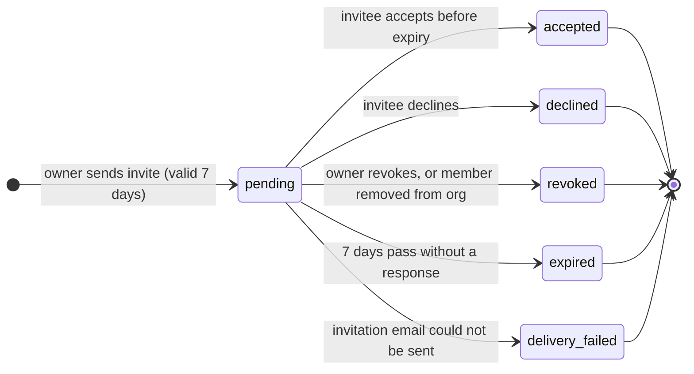
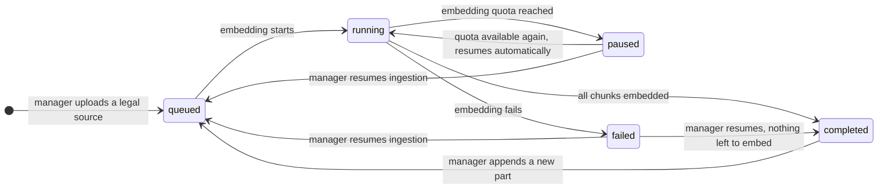

# Core Data Model — States

## State: OrganizationInvitation
**Related entity**: OrganizationInvitation
**Related UC**: —
**Related BR**: —

### Invalid transitions
| From | To | Why not |
|---|---|---|
| expired | accepted | An expired link cannot be accepted, owner sends a new invite |
| revoked / declined / delivery_failed | pending | Closed invitations never reopen, a new invite is created |
| pending | pending (2nd invite) | Only one pending invitation per email per organization |

## State: LegalSourceIngestion
**Related entity**: LegalSource
**Related UC**: —
**Related BR**: —

### Invalid transitions
| From | To | Why not |
|---|---|---|
| queued / running | queued | Cannot resume while embedding is in progress |
| completed | queued (resume) | Every chunk is already embedded, only appending a part restarts it |
