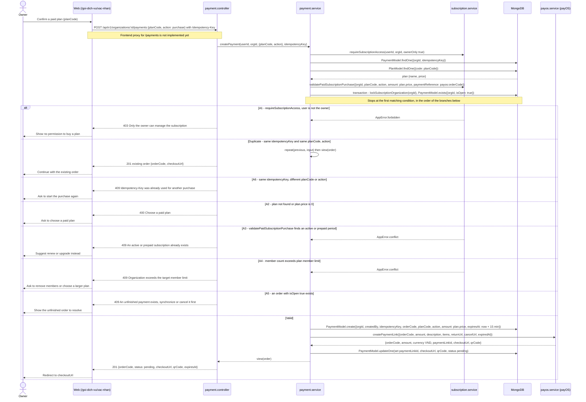
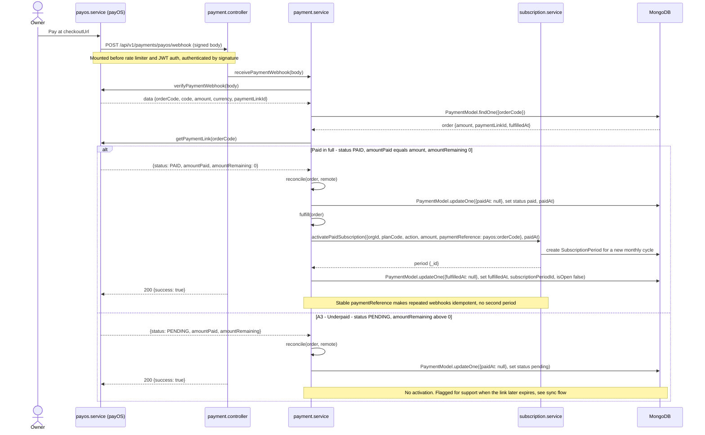
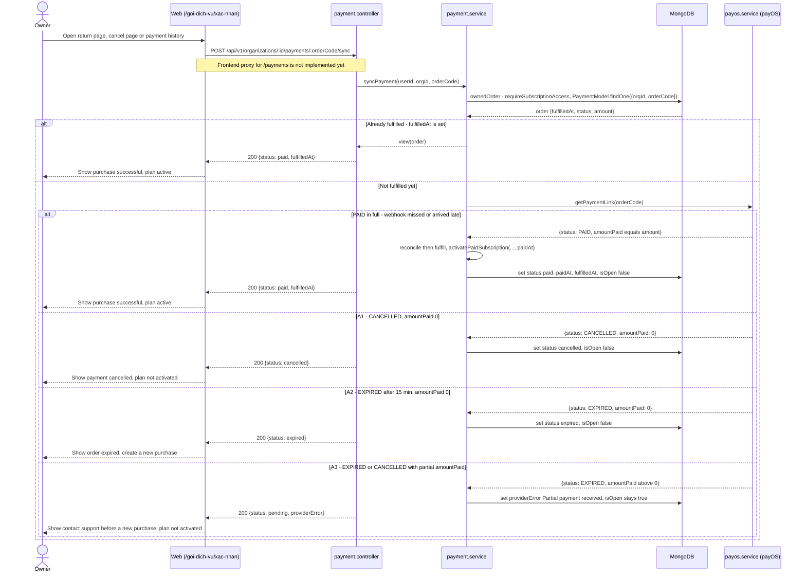

# Subscription — Flows

## Flow: Tạo đơn mua gói
**Trigger**: Chủ tổ chức chọn một gói trả phí và bấm xác nhận mua
**Related UC**: TBD
**Related FR**: TBD
**Related E**: TBD

## Flow: Webhook xác nhận thanh toán và kích hoạt gói
**Trigger**: payOS gửi webhook về `/api/v1/payments/payos/webhook` sau khi có giao dịch
**Related UC**: TBD
**Related FR**: TBD
**Related E**: TBD

## Flow: Đối soát đơn khi người dùng quay lại
**Trigger**: Người dùng quay lại từ payOS (returnUrl hoặc cancelUrl) hoặc mở lại đơn từ lịch sử thanh toán
**Related UC**: TBD
**Related FR**: TBD
**Related E**: TBD

