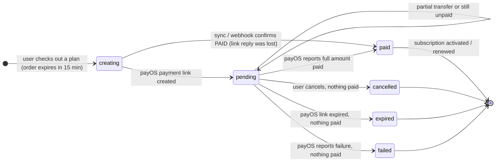
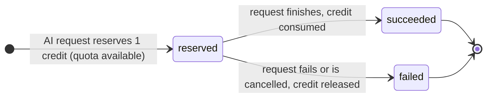

# Subscription — States

## State: Payment
**Related entity**: Payment
**Related UC**: —
**Related BR**: —

### Invalid transitions
| From | To | Why not |
|---|---|---|
| paid | cancelled | A paid order cannot be cancelled |
| pending (partially paid) | cancelled / expired / failed | Partial payments are not discarded, support must handle them |
| cancelled / expired / failed | pending | Closed orders never reopen, user creates a new order |

## State: UsageRun
**Related entity**: UsageRun
**Related UC**: —
**Related BR**: —

### Invalid transitions
| From | To | Why not |
|---|---|---|
| failed | reserved | Retrying needs a new idempotency key (new run) |
| succeeded | failed | A consumed credit is final |
